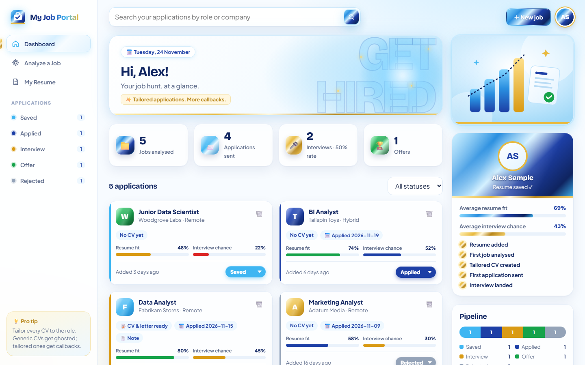
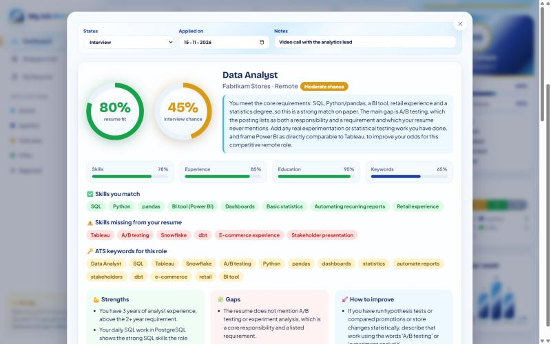
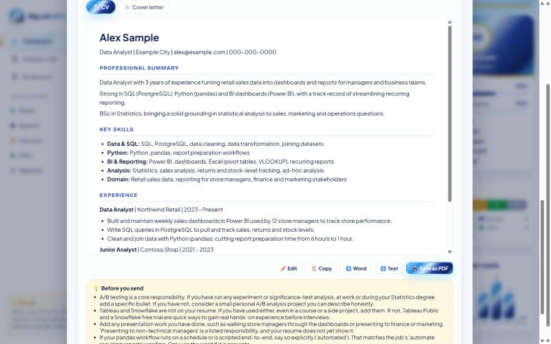

# My Job Portal

**An AI job-application assistant that scores how well your resume fits a job, writes a tailored CV and cover letter, and tracks every application on one dashboard. It runs on your own computer, so your data stays with you.**



> All screenshots use **fictional demo data** ("Alex Sample" and made-up companies). See [Demo data](#try-it-with-demo-data).

---

## The problem

Applying for jobs well takes a lot of time. For every posting you have to judge whether you're a real fit, rewrite your CV around the role's keywords, write a cover letter, and then keep track of where each application stands. Most people end up sending one generic CV everywhere, which is exactly what applicant tracking systems (ATS) and recruiters filter out.

## What it does

| Feature | Details |
|---|---|
| **Read a job** | Paste the job description, or paste a link and press *Fetch*. The app pulls the posting from structured data (JSON-LD `JobPosting`) or the page's main content, skipping menus and footers. |
| **Score the fit** | Resume-fit %, an interview-chance estimate, sub-scores (skills, experience, education, keywords), matched and missing skills, ATS keywords, strengths, gaps and concrete improvements. |
| **Tailored CV and cover letter** | One click writes a CV rewritten for the role plus a matching cover letter. You can edit, copy, or export to Word, text or PDF. |
| **Application tracker** | Saved → Applied → Interview → Offer / Rejected, with the applied date (filled in automatically), notes, search and filters. |
| **Dashboard** | KPIs (jobs analysed, applications sent, interview rate, offers), pipeline, average fit, a progress checklist and applications per week. |

<p>
  
  
</p>

## Keeping the AI honest

A CV tool that invents experience is worse than no tool at all. I designed the prompts and checks around that:

- **Facts only from the resume.** The CV and cover letter prompts allow rewording, reordering and emphasis, but never new skills, employers, dates or numbers. Suggestions for missing skills go into a separate *"Before you send"* list instead of into the CV.
- **Structured output.** Every AI answer must match a JSON schema, so the app never has to parse free text. Scores are clamped to 0–100 on the server.
- **It rejects things that aren't job postings.** If you paste something that isn't a job ad, the app says so instead of scoring it.
- **Verified with live tests** (fictional resume, real API):

| Test | Result |
|---|---|
| Matching role (data analyst → data analyst job) | Fit **80%**, interview chance **45%**. It correctly flagged A/B testing, Tableau and Snowflake as gaps. |
| Generated CV | Contained **none** of the missing skills (Tableau, Snowflake, dbt); only facts from the resume |
| Mismatched role (data analyst → ICU nurse) | Fit **4%**, chance **1%**, with an honest explanation and a better-suited direction |
| Non-job text (a recipe) | Rejected with a clear message |
| Speed | Fit check ≈ 12 s · CV + cover letter ≈ 22 s |

## Privacy by design

- **Local-first.** The server listens only on `127.0.0.1`, and your resume and applications live in a local SQLite file (`storage/`). That folder is git-ignored.
- **Only the AI call leaves the machine.** When you run an analysis, the resume and job text are sent to the Anthropic API, and nothing else is.
- **Safe link fetching.** The fetcher only opens public `http(s)` addresses and refuses private and local network addresses, to prevent server-side request forgery.
- **Separate demo/test storage.** `JOBPORTAL_STORAGE` points the app at another folder, so demos and tests never touch real data.

## Tech stack

- **Backend:** Python, FastAPI, Uvicorn, SQLite
- **AI:** Anthropic Claude API (`claude-opus-5-5`) with JSON-schema structured outputs
- **Frontend:** Vanilla JavaScript, HTML and CSS (no framework). Responsive down to phone width.
- **Files:** PDF and Word resume import (`pypdf`, `docx` parsing), and Word/PDF export
- **Tests:** `pytest` with the AI stubbed out (API flow, score clamping, link-fetch safety, job-page extraction, `.docx` import)

```
server.py          API, database, job-page fetching, resume import
ai.py              Prompts, JSON schemas and the Claude API call
static/            Dashboard UI (index.html, app.js, styles.css)
tests/             Automated tests
demo/              Fictional demo data and seed script
docs/screenshots/  Images for this README
```

## Run it

On Windows, from this folder:

```powershell
python -m venv .venv
```
```powershell
.venv\Scripts\python.exe -m pip install -r requirements.txt pytest httpx
```

Set your Anthropic API key in the same PowerShell window (never commit it):

```powershell
$env:ANTHROPIC_API_KEY = "your-key-here"
```
```powershell
.venv\Scripts\python.exe server.py
```

Open http://localhost:8110. Without a key, the resume, dashboard and tracker still work, and the AI buttons explain that the key is missing.

### Try it with demo data

```powershell
.venv\Scripts\python.exe demo\seed_demo.py
```
```powershell
$env:JOBPORTAL_STORAGE = "demo\storage"; .venv\Scripts\python.exe server.py
```

The demo resume ("Alex Sample") and all companies are fictional. The **Fabrikam Stores** job holds a real result from the Claude API, produced from the fictional resume. The other jobs are hand-written sample entries that fill the dashboard, and their scores are illustrative.

### Run the tests

```powershell
.venv\Scripts\python.exe -m pytest tests -q
```

## Limitations

- Some job sites (LinkedIn, Indeed and others) block automated reading. When *Fetch* fails, paste the job text instead.
- The interview chance is an estimate from the resume and the posting only. It can't see how many people applied, referrals or internal criteria.
- It's single-user and local, with no login. Hosting it online would need authentication and a hosted database first.

## What I'd build next

- Login and a hosted database, so it can be used safely from any device
- A browser extension that sends the job you're viewing straight to the app
- Follow-up reminders and interview-prep questions per application

## How it was built

I designed and built this project with the help of an AI coding assistant (Claude Code). The product decisions were mine: what the tool should do, keeping it local and private, never inventing experience, a separate test mode, and how to verify the AI's output.
